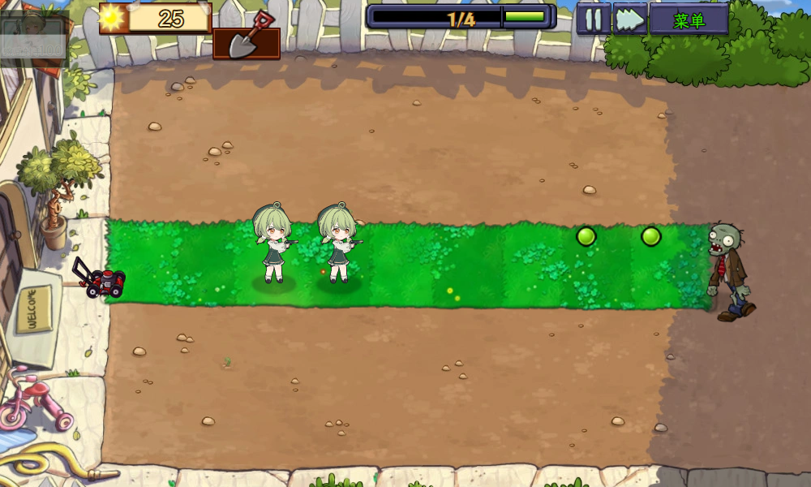

# 植物娘大战僵尸 · 网页移植版 (PlantGirlsVsZombies Web Port)

**原作者：庄不纯。** 原游戏为《植物娘大战僵尸 HD 1.3.2》。本仓库是非官方网页移植与修复版本，原作及素材署名归原作者和各自权利人；完整说明见 [CREDITS.txt](public/CREDITS.txt)。

把 （MonoGame / C# 的《植物娘大战僵尸 HD 1.3.2》，基于开源的 **Lawn** 引擎）
移植成可在浏览器运行的网页游戏。技术栈：**TypeScript + Canvas2D + Vite**，植物娘角色使用官方
**Spine 4.2 runtime**（`@esotericsoftware/spine-webgl`），其余动画沿用原游戏的 PvZ **Reanim** 格式。

## 2026-11-15 修复与实玩

本轮重新核对原版 C# 和截图，纠正了旧验收中遗漏的根本问题：XNB Color 误用 BGRA 导致红蓝颠倒；Reanim 漏算半幅偏移导致部件散架；普通僵尸被错误镜像。阳光已恢复原始金色，移除了补偿偏色的滤镜。

植物娘改用 WebGL 绘制，消除 Canvas 网格三角形接缝，恢复 Spine 物理运动，并使用原版 `1.25 / 16` 缩放。另已恢复 1-1 单行、1-2/1-3 三行草坪与对应小车/出生排；补齐玩家选卡、竖向运动传送带、1-5 滚坚果/反弹/爆炸/红线限制、原版按钮、卡片名称价格、初始冷却、枪口坐标、撑杆完整跳跃和动画速度。修正低帧率丢 tick、铲子点击范围、右键取消和双发待发子弹残留。

真实 Chrome 鼠标输入实玩 1-1 通关（自然阳光、自然波次，无修改生命/阳光/波次）；1-1～1-10 加载检查及选卡、动画运动、护甲、命中顺序、矿雷、撑杆、滚坚果专项回归通过。记录见 [本轮检查报告](docs/audit-2026-11-15.md)。旧验收记录保留作历史；与本节冲突时以本轮修正为准。



## 快速开始

下载 GitHub Releases 中的网页运行包，解压后双击 `启动游戏.bat`（需要 Node.js），再打开终端显示的本地地址。也可在解压目录运行 `node serve.cjs`。运行包已包含游戏资源，无需安装 npm 依赖。

```powershell
cd D:\逆向\plangirls-web
npm install          # vite / typescript / @esotericsoftware/spine-webgl
npm run dev          # http://127.0.0.1:5188/
npm run build        # tsc + vite build + 把 data/ 复制进 dist/data（产物自包含，可直接静态托管）
npm run package      # 重新构建并生成 artifacts/ 下的 ZIP 运行包（Windows）
```

打开后点 **开始冒险 → 选关 → 点击种子包/传送带卡片 → 点击草地种植**。
调试用 URL 参数：`?autostart=1&level=1`、`&sun=9999`、`&speed=1..3`、`&spawn=Polevaulter&row=1`（验证用刷怪）。

## 已实现

| 模块 | 说明 |
| --- | --- |
| 资源管线 | 原始 XNB（`flag 0x40 + LZ4`）→ 图集 WebP + sprite 清单（1876 切片 / 5 图集）+ 独立图 + 字体 + 音乐 + Spine 骨架；关卡/植物/僵尸/文案/枚举数据全部脚本生成 |
| 图集采样 | 严格按原 `Sexy/PrimitiveBatch.cs` 的 `mInvScale` UV 公式采样（源区间 = `inv * 逻辑尺寸`），修复串图/碎片 |
| Reanim 播放器 | 全局帧轴、动画窗口、100Hz 步进、逐帧插值（spec §3.2）、居中精灵、轨道顺序、alpha/frame/skew、镜像、渲染组隐藏（路障/铁桶/纱窗门等按 `Zombie.SetupReanimLayers`） |
| 植物娘 | Spine 4.2 二进制骨架（peashooter/sunflower/snowpea/repeater/chomper 等），idle / shooting 切换、射击后回 idle |
| 关卡模拟 | 100Hz：阳光掉落/收集、种子冷却、9×5 草坪、弹道（**优先命中路径上最近的僵尸**）、僵尸行走/啃食/受击/死亡、护甲（路障/铁桶）残留与脱落、小推车、波次（含血量阈值加速与旗帜预警）、胜负 |
| 卡片模式 | 固定卡组、玩家点击选卡、左侧竖向传送带（1-5 / 1-10，免费种植）、1-5 滚坚果与预置三株豌豆射手、铲子铲除 |
| 特殊植物/僵尸 | Chomper 吞噬（windup→digest）、Explode-o-nut 死亡爆炸、Cherrybomb、Potato Mine、Repeater 连发延时、Polevaulter 撑杆跳跃（Tall-nut 阻挡） |
| HUD | 原版种子包美术（含中文名/价格）、阳光板、旗帜进度条（225px 填充）、关卡横幅（y=565）、暂停/倍速/菜单、提示、胜负画面 |
| 音频 | 原版 OGG 音乐 + WebAudio 合成音效（占位） |

## Codex 独立验收记录（gpt-6.1-sol, reasoning=medium）

按用户要求，移植完成后用 Codex（`gpt-6.1-sol`，reasoning=medium）做独立验收并按其意见修改，
共 4 轮（真实 Chrome/CDP 驱动，审查期间不改被审代码）：

| 轮次 | 结论 | 主要问题 | 处理 |
| --- | --- | --- | --- |
| 第 1 轮 | 不通过 | 7 项 P1：图集采样比例错误（串图/碎片）、非 Spine 植物不可见、1-5/1-10 传送带与 1-5 预置植物缺失、撑杆僵尸、弹丸命中顺序、Spine 射击停帧、波次调度；另有多项 P2 | 全部修复（见下） |
| 第 2 轮 | 不通过 | 2 项 P1：Chomper 缺 Spine 第二页贴图（不可见）、旗帜预警未门控出生；P2：Reanim 插值跳变、菜单调试闭包残留、射击动画被截断 | 补齐 `chomper_2.png` 等 atlas 页；预警冻结倒计时；插值改 floor(t)；清理闭包；按轨道完成回 idle |
| 第 3 轮 | 不通过 | 1 项 P1：`hugeWaveTimer` 双重递减（750 tick 变 375）；1 项 P2：终态尸体/运行中小车不清理 | 计时唯一递减点；终态分支递减 dieTimer 并推进小车 |
| 第 4 轮 | **通过** | 无新增问题 | 收尾确认（预警完整 750 tick、终态清理、构建/数据一致性、回归全通过） |

报告与截图证据：`docs/codex-review.md`、`codex-review-2.md`、`codex-review-3.md`、`codex-review-4.md`；
`docs/shots/codex*.png`、`docs/shots/fix-*.png`。

主要修复点：
- **图集采样**：按原 `Sexy/PrimitiveBatch.cs` 的 `mInvScale` UV 规则采样（源区间 = inv × 逻辑尺寸，目标 = 逻辑尺寸），1876 切片 0 越界。
- **加载闭包**：`resolveLoadout()` 统一解析固定卡组/选卡/传送带/预置植物，供预加载与卡组共用；非 Spine 植物优先 `resourcePath`，Spine 才用 legacy fallback。
- **传送带**：1-5/1-10 免费种植、按权重补卡、禁自然落阳、1-5 预置三株豌豆；Chomper 吞噬、Explode-o-nut 死亡爆炸。
- **撑杆僵尸**：vault 状态（接近→跳跃→落地→降速），Tall-nut 阻挡。
- **命中顺序**：同排重叠僵尸取路径上最近者。
- **Spine**：攻击动画强制重播、按轨道完成回 idle；补齐多页 atlas。
- **波次**：血量阈值加速、`hugeWaveCountDownTicks`（750）门控旗帜预警、旗波后 4500 tick 且阈值归零、单一计时递减点。
- **Reanim 插值**：before=floor(t)、frac=小数余量（与反编译 C# 一致），并读取 `doc.interpolate`；同步修正 `docs/spec-reanim.md` 的错误描述。
- **其他**：路障/铁桶别名（TrafficCone/Pail）、HUD 数值（进度条 225、横幅 565、按钮 45、铲子+铲除）、小车/预览缓存、胜利后尸体退场、菜单调试全局清理、阳光点击盒 143×143、落阳倒计时顺序、Repeater 第二发延时、`npm run build` 产物自包含（`dist/data`，含 Chomper 第二页）。

## 目录结构

```
plangirls-web/
├─ data/                     # 由 tools/ 脚本生成（勿手改）
│  ├─ atlas.json / sprites.json / resources.json
│  ├─ levels/plants/zombies.json, layout.json, reanim_params.json
│  ├─ reanim/*.json（150 个）, tex/*.webp, spanim/*, fonts, music, strings_zh, seedtypes
├─ src/
│  ├─ assets.ts              # 资源加载、图集采样（invScale）、过滤缓存、Spine 预载
│  ├─ reanim.ts              # Reanim 播放（插值）+ 绘制
│  ├─ spine.ts               # Spine 加载与绘制
│  ├─ game/board.ts          # 关卡模拟 + 渲染 + 输入（核心）
│  ├─ scenes/menu.ts         # 标题 / 选关
│  ├─ shell.ts / boot.ts     # 场景切换、100Hz 固定步进主循环、视口缩放
│  └─ audio.ts
├─ tools/                    # 资产/数据管线
│  ├─ xnb.py                 # XNB 解码（LZ4 / Color / DXT1）
│  ├─ build_assets.py        # 图集/独立图/字体/音乐/Spine/文案导出
│  ├─ atlas_manifest.py      # AtlasResources_600x1000.cs → 图集切片
│  ├─ reanim2json.py         # Reanim XNB → JSON
│  ├─ extract_levels.py      # 反编译 C# → levels/plants/zombies.json
│  ├─ copy-data.mjs          # 构建时把 data/ 复制到 dist/
│  └─ shot.mjs               # 无依赖 CDP 截图/交互/报错采集
└─ docs/                     # 规范文档、Codex 验收报告、原版/验证截图
```

## 与 kimi-k3 (opencode) 的协作

按用户要求使用 `opencode` 中的 **kimi-k3** 作为辅助 agent，独立完成并通过验收：
`tools/atlas_manifest.py`、`data/atlas.json`、`data/resources.json`、`docs/kimi-atlas-report.md`
（89 图集 / 5150 切片 / 0 冲突）。XNB 解码任务初版超时后由主 agent 接手（发现本作 XNB 使用
`flag 0x40 + LZ4`，非标准 0x80/XCompress），结论已写入 README。

## 验证

* **Codex 独立验收**（真实 Chrome/CDP 驱动）：`docs/codex-review.md`（首轮，不通过 + 7 P1）、
  `docs/codex-review-2.md`（修复后复审）。
* 自动化验证工具：`node tools/shot.mjs --url ... --wait ... --actions '[{"click":[...]},{"shot":"..."}]' --eval '...'`，
  通过 `window.__getState()` 读取实时状态；截图见 `docs/shots/final-*.png`、`docs/shots/fix-*.png`
  （菜单/选关/战斗/通关/传送带/撑杆/非 Spine 植物）。
* `npx tsc --noEmit`、`npm run build`（含数据拷贝）通过。

## 已知限制（后续可做）

1. 只移植冒险模式白天 1-1～1-10；夜晚/泳池/屋顶/小游戏/禅境花园/商店/图鉴未移植。
2. 草坪排数已恢复，但完整开场镜头、铺草动画、教学对话脚本未移植。
3. 选卡已可实际操作，但布局为网页实现；Endoflame 尚无可用植物定义，未列入可选卡。
4. 滚坚果已实现；粒子、掉落护甲、死亡细节等仍有近似效果，尚未达到逐像素一致。
5. 菜单和结算仍为网页实现，使用原版背景/按钮素材，未完整复刻原版所有界面。
6. 原版 177 个 SoundEffect XNB 编码格式未逆向，音效为 WebAudio 合成占位；音乐为原版 OGG。
7. 存档/金币/成就/选卡存档、移动端触屏适配未实现；大量未移植的 Reanim 素材（Chomper 等 fallback）缺图。

## 许可 / 素材来源

游戏素材与数值来自本机已安装的《植物娘大战僵尸 HD 1.3.2》（`D:\逆向\PlantGirlsVsZombies`），
仅用于本次移植研究；Spine runtime 使用 Esoteric Software 的授权条款（见 `node_modules/@esotericsoftware/spine-webgl/LICENSE`）。
